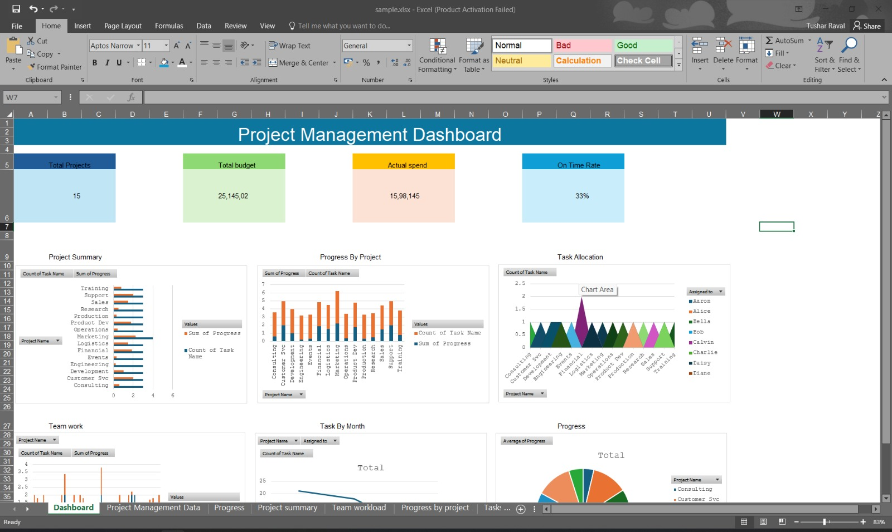
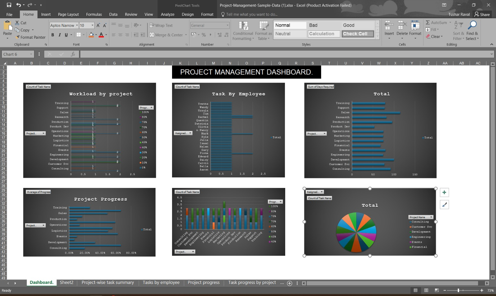
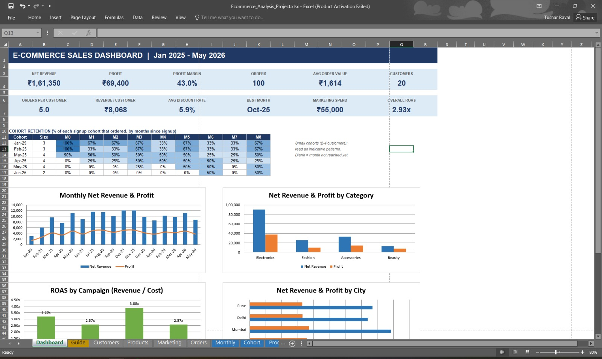

👋 Hi, I'm Tushar Raval
🚀 Aspiring Product Manager | Product Analyst | UI/UX Enthusiast | Data Analytics

I enjoy solving real-world problems through product thinking, user-centric design, research, and data-driven decision-making.

My portfolio showcases my work across Product Management, Product Documentation, UX Case Studies, Figma Design, and Excel Dashboards.

🚀 MY PROJECTS & PORTFOLIO
📌 PRODUCT MANAGEMENT & CASE STUDIES
⭐ 1. PayNova – AI-Powered Payment Ecosystem

An AI-powered payment ecosystem designed to help users pay, save, protect, and understand their money through intelligent financial assistance.

🔗 VIEW PAYNOVA – PRODUCT REQUIREMENTS DOCUMENT (PRD) Link :- https://eminent-bongo-6f3.notion.site/PayNova-3bbadc3c351380fe906aff6088259b0a

🔗 VIEW PAYNOVA – PRODUCT DOCUMENTATION Link :- https://granite-adapter-929.notion.site/PayNova-3b26f9b5a516806c8150dc6557573da1

⭐ 2. Offiio AI – AI-Powered Chatbot

A product concept focused on an AI-powered chatbot designed to improve user interactions and provide intelligent conversational assistance.

🔗 VIEW OFFIIO AI – PRODUCT REQUIREMENTS DOCUMENT (PRD) Link :- https://eminent-bongo-6f3.notion.site/Offiio-AI-Product-Requirements-Document-PRD-403adc3c351380289145d1c7a2f69eaf

⭐ 3. TypeBetter – Improving Online Typing Course Completion

A product case study exploring how online typing platforms can improve learning experiences, typing speed, accuracy, and course completion through structured lessons and interactive practice.

🔗 VIEW TYPEBETTER – PRODUCT CASE STUDY Link :- https://eminent-bongo-6f3.notion.site/TypeBetter-Improving-Online-Typing-Course-Completion-405adc3c351380608777db6a6b9a6a5b

⭐ 4. Typing Blaze – Typing Tutor Product

A product documentation project focused on an online typing tutor experience, designed to support typing practice and improve the learning journey.

🔗 VIEW TYPING BLAZE – PRODUCT REQUIREMENTS DOCUMENT (PRD) Link :- https://eminent-bongo-6f3.notion.site/Typing-Blaze-Tutor-Product-Requirements-Document-3bbadc3c35138097a170e1f95d270dbc

⭐ 5. MoveMate – Mobile-First Relocation Platform

A mobile-first relocation platform designed to help people plan, organize, and complete their move from one place.

The project focuses on simplifying the relocation journey through better planning, organization, and user experience.

🔗 VIEW ZipMove – PRODUCT REQUIREMENTS DOCUMENT (PRD) Link :- https://eminent-bongo-6f3.notion.site/ZipMove-Product-Requirements-Document-PRD-3bbadc3c351380f08208c04e0c3b1298

🔗 VIEW MOVEMATE – PRODUCT CASE STUDY Link :- https://granite-adapter-929.notion.site/MoveMate-3b86f9b5a516807bb7bbf135af7ea85a

⭐ 6. VRL Logistics – Improving Shipment Visibility

A B2B logistics case study focused on improving shipment visibility and delivery communication for business customers.

The objective is to identify communication gaps and explore opportunities to improve shipment tracking and customer experience.

🔗 VIEW VRL LOGISTICS – PRODUCT CASE STUDY Link :- https://eminent-bongo-6f3.notion.site/VRL-Logistics-Improving-Shipment-Visibility-and-Delivery-Communication-for-B2B-Customers-405adc3c351380548f09e35c61bb29c6

⭐ 7. Zerodha Kite – Product Teardown & UX Analysis

A product teardown of Zerodha Kite, evaluating its user experience, functionality, customer journey, competitive positioning, and opportunities for improvement.

The objective is to identify potential user friction points and recommend product enhancements to improve usability, customer satisfaction, and engagement.

🔗 VIEW ZERODHA KITE – PRODUCT TEARDOWN & UX CASE STUDY Link :- https://eminent-bongo-6f3.notion.site/ZERODHA-CASESTUDY-UX-ANALYSIS-40cadc3c3513802d9df7d43f3f35df3e

🎨 UI/UX DESIGN – FIGMA PROJECTS
🎯 1. MoveMate – Mobile Application Design

A mobile application prototype focused on simplifying the relocation experience through user-friendly interfaces and intuitive navigation.

🛠️ Tool: Figma

🔗 VIEW MOVEMATE – FIGMA PROTOTYPE

🎯 2. Fitness Application – Mobile App Design

A fitness application design project created in Figma to demonstrate mobile UI design, visual hierarchy, and user experience design skills.

🛠️ Tool: Figma

🔗 VIEW FITNESS APP – FIGMA DESIGN Link :- https://www.figma.com/design/Jxpgb90ccNr4s0Fn7W6E2C/Fitness-Beta-Design?node-id=14-514

🎯 3. Typing Blaze – Website UI Design

A website design project focused on creating a user-friendly online typing learning experience.

🛠️ Tool: Figma

🔗 VIEW TYPING BLAZE – FIGMA WEBSITE PROTOTYPE Link :- https://www.figma.com/proto/B1ia2I2JYSBRWYmqaSah9F/TypingBlaze?node-id=3-184&p=f&t=5OjxVyg9AZw6o8SH-1&scaling=min-zoom&content-scaling=fixed&page-id=0%3A1

📊 DATA ANALYTICS – MICROSOFT EXCEL DASHBOARD

I also work with Microsoft Excel to organize data, analyze information, and create visual dashboards that make insights easier to understand.

📈 EXCEL DASHBOARD SHOWCASE

<!-- Upload your dashboard screenshot to the images folder in your GitHub repository -->
dashboad 1

dashboad 2

dashboad 3

🛠️ Tool: Microsoft Excel

Dashboard visualization showcasing my Excel, data analysis, and data presentation skills.

🛠️ SKILLS & TOOLS
Category	Skills & Tools
📌 Product Management	PRD, Product Strategy, Product Thinking, Product Documentation
📊 Product Analysis	Product Teardown, Competitor Analysis, User Journey Analysis
🎨 UI/UX Design	Figma, Wireframing, UI Design, UX Research
📈 Data Analytics	Microsoft Excel, Dashboard Creation, Data Visualization
📚 Documentation	Notion, GitHub, Product Documentation
🎯 AREAS OF INTEREST
Product Management
Product Analyst Opportunities
Business Analysis
UI/UX and Product Design
Data-Driven Product Development
🤝 LET'S CONNECT!

I'm always interested in learning, collaborating, and working on meaningful product challenges.

Thank you for visiting my portfolio! ⭐
